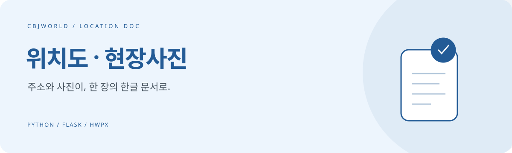

# 위치도 · 현장사진 · Location Doc

**지도 캡처와 사진 붙여넣기를, 한 번의 문서 생성으로.**

주소를 검색하고 현장사진을 선택하면 위치도와 사진이 들어간 **HWPX 한글 문서**를 만듭니다. 현장 확인 자료와 보고서 첨부 문서를 준비할 때 사용할 수 있습니다.

### [→ 웹앱 열기](https://location-doc.vercel.app)

`Python` · `Flask` · `Pillow` · `Kakao Maps` · `HWPX`

## 입력에서 문서까지

| 입력 | 처리 | 결과 |
| --- | --- | --- |
| 주소 + 현장사진 | 지도 조회·위치 표시·이미지 배치 | 위치도 및 현장사진 `.hwpx` |

- 주소 검색과 지도 위치 조정
- 지도 위 표시 원을 포함한 위치도
- 현장사진을 한글 서식에 배치
- 주소를 포함한 파일명으로 다운로드

## 사용 방법

1. 주소를 검색하고 지도에서 대상 위치를 확인합니다.
2. 지도 범위와 위치 표시를 조정합니다.
3. 현장사진을 선택합니다.
4. 문서를 생성해 내려받고 한글에서 내용과 배치를 확인합니다.

## 로컬 실행

```bash
git clone https://github.com/cbjworld/location-doc.git
cd location-doc
python -m venv .venv
```

가상환경을 활성화하고 의존성을 설치합니다.

```bash
pip install -r requirements.txt
```

실행 환경에 `KAKAO_JS_KEY`와 `KAKAO_REST_KEY`를 설정한 뒤 실행합니다.

```bash
flask --app app run
```

`http://127.0.0.1:5000`에서 엽니다. 카카오 JavaScript 키의 허용 도메인에 실행 주소를 등록해야 합니다. REST 키는 서버 환경변수에만 보관하세요.

## 구성

| 파일 | 역할 |
| --- | --- |
| `app.py` | 웹 화면·주소 검색·문서 생성 API |
| `hwpx_generator.py` | HWPX 문서 조립 |
| `templates/index.html` | 주소·지도·사진 입력 화면 |
| `template/` | 한글 문서 템플릿 |

## 처리 방식과 제한

**사진과 지도 이미지는 서버를 거쳐 처리됩니다.** 수합기와 달리 브라우저 안에서만 처리되는 도구가 아닙니다. 서버에서는 요청별 임시 폴더를 사용하며 처리가 끝나면 임시 파일을 정리합니다. 민감한 자료는 사용 환경의 보안 정책을 확인하세요.

브라우저는 사진 크기를 줄여 전송하며, 서버의 요청 본문 한도는 4MB입니다. 지도 조회는 카카오 API 키와 이용 한도에 영향을 받습니다. 현재 코드에 별도의 사용자 인증은 없으므로 기관 내부 운영에는 접근 제어를 검토하세요.

## 기존 배포 안내

## 배포 순서
1. 이 폴더를 GitHub 저장소에 올립니다.
2. https://vercel.com → Add New → Project → 저장소 Import (Framework: Other, 설정 변경 없음).
3. Settings → Environment Variables 에 추가:
   - `KAKAO_JS_KEY` : 카카오 JavaScript 키
   - `KAKAO_REST_KEY` : 카카오 REST API 키
4. Deploy. 완료되면 `https://프로젝트명.vercel.app` 주소가 생깁니다.
5. 카카오디벨로퍼스 → 앱 → 플랫폼 키 → JavaScript 키 → **JavaScript SDK 도메인**에
   `https://프로젝트명.vercel.app` 을 등록합니다. (커스텀 도메인을 쓰면 그것도 등록)
   REST 키의 "호출 허용 IP"는 비워두세요(Vercel은 IP가 고정이 아닙니다).
6. 환경변수를 바꾼 뒤에는 Redeploy 해야 반영됩니다.

CLI로 배포하려면: `npm i -g vercel && vercel --prod`


## 함께 개선해요

유용했다면 **⭐ Star**로 응원해 주세요. [Issues](https://github.com/cbjworld/location-doc/issues)에 오류 재현 방법이나 개선 아이디어를 남겨주시면 도움이 됩니다. 예시 자료에서 개인정보와 비공개 데이터는 제거해 주세요.

**English:** Generate a Korean HWPX document from an address, a marked map image and a site photo. Built with Flask and Pillow; images are processed on the server.
